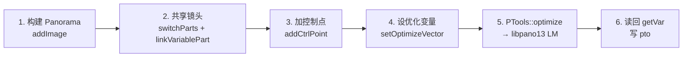

# Hugin 最小化标定引擎 — 使用与集成文档

**版本**: 1.0  |  **日期**: 2026-08-20  |  **平台**: RK3588 (aarch64, Ubuntu 22.04)

---

## 1. 背景与目标

Hugin 是著名的全景拼接软件，其核心价值之一是**基于控制点的镜头标定优化器**。
本项目从 Hugin 源码（2025.0.1）中抽取最小标定核心，目标是：

1. 在 **RK3588 (aarch64)** 上以最少的依赖编译出一个可用的标定引擎；
2. 用 **棋盘格角点**（OpenCV 检测）作为控制点输入；
3. 输出 **AVS 兼容的 pto**（`v/a/b/c` + 每图 `y/p/r`），直接供 Rockchip AVS 拼接使用。

```
棋盘图 ──OpenCV──▶ 角点 ──网格索引配对──▶ 控制点 ──hugin_min──▶ v/a/b/c + y/p/r ──▶ AVS pto
```

**最终产物**: `/root/hugin_min/build/hugin_calib_driver`（aarch64 原生可执行文件）

---

## 2. 标定算法原理

### 2.1 镜头模型

Hugin 的镜头模型 = **投影类型(f) + 视场角 v + 径向畸变 a/b/c**：

- **投影类型** `f`：理想投影方程（9 种，见 2.3）；
- **视场角** `v`（度）：**焦距的等价表达**，两者一一对应、随投影类型换算；
- **径向畸变** `a,b,c`：修正真实镜头对理想投影的偏差。

畸变模型（libpano13 约定，r 归一化到画面角点 r=1）：

$$r' = r\,(a + b\,r^2 + c\,r^4 + d\,r^6), \qquad d = 1 - (a+b+c)$$

pto 里还有：`d,e`（径向畸变中心偏移）、`g,t`（剪切）、`y/p/r`（姿态）、`TrX/TrY/TrZ`（平移）。

### 2.2 优化原理

`PTools::optimize()` 内部流程（`PanoToolsOptimizerWrapper.cpp` → libpano13）：

1. 把 pano（图像参数 + 控制点）序列化为 pto 脚本；
2. libpano13 `ParseScript` 解析 → 构建 `AlignInfo`；
3. 误差函数 `fcnPano` 计算每个控制点的重投影残差；
4. **Levenberg-Marquardt**（levmar）迭代最小化残差平方和；
5. 结果写回 pano 的变量（`v/a/b/c/y/p/r`）。

### 2.3 支持的投影类型（pto 的 `f` 字段）

| f | 类型 | 说明 |
|---|---|---|
| 0 | RECTILINEAR | 普通透视（标定验证用） |
| 1 | PANORAMIC | 圆柱 |
| 2 | CIRCULAR_FISHEYE | 圆形鱼眼 |
| 3 | **FULL_FRAME_FISHEYE** | **全帧鱼眼（AVS 默认）** |
| 4 | EQUIRECTANGULAR | 等距柱状 |
| 8 | FISHEYE_ORTHOGRAPHIC | 正射鱼眼 |
| 10 | FISHEYE_STEREOGRAPHIC | 立体投影鱼眼 |
| 20 | FISHEYE_THOBY | Thoby 鱼眼 |
| 21 | FISHEYE_EQUISOLID | 等立体角鱼眼 |

优化器对投影类型完全通用——只需设置 `f`，其余流程相同。

### 2.4 与 AVS 的模型对应

AVS 读取 hugin 格式 pto，其镜头模型（`f3` 全帧鱼眼 + `v` + `a,b,c`）与 Hugin **完全同构**：
畸变归一化约定一致（r=1 在画面角点），**优化出的 `v/a/b/c` 可直接喂给 AVS，无需换算**。

> ⚠️ 注意：这与 camodocal 的 MEI/KB 模型（含主点 cx/cy、不同归一化）**不是同一套约定**，不要混用。

---

## 3. 工程结构

```
/root/hugin_min/
├── CMakeLists.txt              # 最小构建脚本
├── README.md                   # 快速上手
├── DOCUMENTATION.md            # 本文档
├── src/
│   ├── driver.cpp              # 标定驱动（命令行）
│   ├── stubs.cpp               # getExposureLayers 桩
│   ├── hugin_config.h          # 手写配置头
│   ├── hugin_version.h         # 手写版本头
│   ├── hugin_shared.h          # IMPEX 宏（非 Windows 为空）
│   ├── hugin_base/             # 抽取的 Hugin 核心源码
│   │   ├── panodata/           #   全景数据结构
│   │   ├── panotools/          #   优化器封装
│   │   ├── algorithms/basic/   #   CalculateOverlap
│   │   ├── hugin_math/         #   矩阵/向量数学
│   │   ├── hugin_utils/        #   工具函数
│   │   └── appbase/            #   基础头文件
│   ├── levmar/                 # 自带 LM 求解器（纯 C）
│   └── vigra/                  # VIGRA 头文件（备用，构建时优先用 /opt/vigra）
└── build/
    └── hugin_calib_driver      # ✅ aarch64 可执行文件
```

### 编译的源码文件（~22 个 + levmar）

`panodata/`（Panorama, PTScriptParsing, PanoramaOptions, PanoramaVariable, SrcPanoImage,
Lens, ControlPoint, Mask, ImageVariableGroup, StandardImageVariableGroups, ParseExp）、
`panotools/`（PanoToolsInterface, PanoToolsOptimizerWrapper）、`algorithms/basic/CalculateOverlap`、
`hugin_math/`（hugin_math, Matrix3, Vector3, eig_jacobi）、`hugin_utils/`（utils, alphanum）、
`foreign/levmar`（lm, Axb, misc）、`src/stubs.cpp`。

---

## 4. 编译指南（RK3588 / aarch64）

### 4.1 依赖总览

| 依赖 | 来源 | 必须 | 说明 |
|---|---|---|---|
| **libpano13 ≥ 2.9.19** | `apt install libpano13-dev` | ✅ | 优化器/投影数学核心（纯 C） |
| **VIGRA ≥ 1.9** | 源码编译 → `/opt/vigra` | ✅ | 只用类型 + impex 符号 |
| **liblcms2** | `apt install liblcms2-dev` | ✅ | utils 里 ICC 函数 |
| Boost | — | ❌ | 已确认核心路径零使用 |
| wxWidgets | — | ❌ | 砍掉 hugin1 GUI |
| OpenEXR / TIFF / JPEG / FFTW / OpenGL / SQLite / EXIV2 | — | ❌ | 全部砍掉 |

> **关键点**：aarch64 的 Ubuntu 仓库**没有 VIGRA 包**，必须源码编译；
> x86_64 桌面有 `libvigraimpex-dev` 可直接装（仅验证用）。

### 4.2 VIGRA 源码编译

```bash
git clone --depth 1 --branch Version-1-11-2 \
    https://github.com/ukoethe/vigra.git /root/vigra

# 修一个 CMake bug：CMakeLists.txt 第 343-347 行
#   ADD_DEPENDENCIES(PACKAGE_SRC_TAR doc_cpp)   →  包进 IF(BUILD_DOCS) 内
# 否则 BUILD_DOCS=OFF 时 configure 报 ADD_DEPENDENCIES 找不到 target

cd /root/vigra && mkdir build && cd build
cmake -DCMAKE_INSTALL_PREFIX=/opt/vigra \
  -DWITH_OPENEXR=OFF -DWITH_HDF5=OFF -DWITH_BOOST_GRAPH=OFF \
  -DWITH_VIGRANUMPY=OFF -DWITH_FFTW=OFF \
  -DWITH_JPEG=OFF -DWITH_PNG=OFF -DWITH_TIFF=OFF -DWITH_ZLIB=OFF \
  -DBUILD_TESTS=OFF -DBUILD_DOCS=OFF ..
make -j4 && make install
# 产物: /opt/vigra/include/vigra + /opt/vigra/lib/libvigraimpex.so
```

### 4.3 构建 hugin_min

```bash
apt install -y libpano13-dev liblcms2-dev
cd /root/hugin_min
cmake -S . -B build
cmake --build build -j4
# 产物: build/hugin_calib_driver
```

### 4.4 依赖裁剪与补丁清单（相对完整 Hugin）

**整目录砍掉**：`hugin1/`(GUI+wxWidgets)、`hugin_cpfind/`、`nona/`、`photometric/`、
`lensdb/`(SQLite)、`vigra_ext/`(除工具)、`LayerStacks.cpp`（Panorama.cpp 只 include 不调用）。

**打补丁的文件**（副本，原版 `/root/hugin` 未动）：

| 文件 | 补丁内容 |
|---|---|
| `panodata/SrcPanoImage.cpp` | 删除 exiv2/lensdb include；`readEXIF()` 返回 false；`checkImageSizeKnown()` 不读图；镜头数据库方法整体 `#if 0`；`getExifDateTime()` 返回 -1 |
| `hugin_utils/utils.cpp` | GPU/GL 代码（`CreateContext`/`initGPU`/`wrapupGPU`）`#if 0`；删除 GL/EGL/X11 include（保留 lcms2） |

**链接期坑**（已解决）：

1. VIGRA headers-only 不够 —— 需要编译库符号 `vigra::isImage`、`vigra::impexListExtensions`；
2. `Panorama.cpp` 调用 `getExposureLayers` —— 用 `src/stubs.cpp` 提供桩（标定不需要曝光分层）；
3. `LayerStacks.cpp` 依赖 `ImageGraph`/`estimateOutputROI` —— 直接不编译该文件（仅 include 无调用）。

---

## 5. 命令行使用

### 5.1 参数

```bash
./build/hugin_calib_driver \
  --width  3840 \        # 图像宽 (px)
  --height 2160 \        # 图像高 (px)
  --proj   3 \           # 投影 f-code (默认 3=全帧鱼眼)
  --hfov   151 \         # v 初值 (度) —— 从 AVS 配置读
  --crop   4.85 \        # crop factor（仅元数据）
  --images 4 \           # 相机数
  --cp     cp.txt \      # 控制点文件
  --out    result.pto \  # 输出 pto
  --opt    v,a,b,c,y,p,r # 可选：优化变量集合（默认 图0: v,a,b,c / 其他: y,p,r）
```

### 5.2 控制点文件格式

每行一个 2D 对应（**X_Y 模式**），0 基图像号，像素坐标：

```
# 注释行以 # 开头
img1 x1 y1 img2 x2 y2
0   960.5 540.2 1 1012.3 543.1
0   1920.0 1080.0 2 1880.4 1075.9
...
```

**棋盘格控制点生成**：用 OpenCV `findChessboardCorners`/`findChessboardCornersSB`
检测每帧角点 → 按**网格索引 `(r,c)`** 跨图配对（同一棋盘格物理点）→ 写入该文件。
⚠️ 对称棋盘需统一角点顺序，建议用**不对称棋盘**或透视校正消除歧义。

### 5.3 输出 pto 格式（AVS 兼容）

```
#hugin_optimizeReferenceImage 0
i w3840 h2160 f3 v151.01 a0.001 b-0.002 c0.001 y0 p0 r0 n"camera_0.jpg"
i w3840 h2160 f3 v151.01 a0.001 b-0.002 c0.001 y-20.3 p0.01 r0.0 n"camera_1.jpg"
```

- **多相机共享镜头**：所有相机输出同一 `v/a/b/c`（对应 AVS pto 的 `v=0 a=0...` 链接语义）；
- 光度字段（`Ra..Re` `Eev Er Eb` `Va..Vd` `Vm5`）由 AVS 原样透传，Hugin 不处理。

---

## 6. C++ API 编程指南

### 6.1 六步流程



### 6.2 核心代码

```cpp
#include <panodata/Panorama.h>
#include <panodata/SrcPanoImage.h>
#include <panodata/ControlPoint.h>
#include <panodata/StandardImageVariableGroups.h>
#include <panotools/PanoToolsOptimizerWrapper.h>
using namespace HuginBase;

// 1. 构建 pano
Panorama pano;
const vigra::Size2D size(3840, 2160);
for (int i = 0; i < N; ++i) {
    SrcPanoImage img;
    img.setProjection(BaseSrcPanoImage::FULL_FRAME_FISHEYE); // f3
    img.setSize(size);
    img.setHFOV(151.0);                    // v 初值
    img.setRadialDistortion({0.0,0.0,0.0}); // a,b,c 初值
    img.setYaw(0); img.setPitch(0); img.setRoll(0);
    img.setCropFactor(4.85);               // 元数据
    img.setFilename("camera_" + std::to_string(i) + ".jpg");
    pano.addImage(img);
}
PanoramaOptions opts = pano.getOptions();
opts.optimizeReferenceImage = 0;           // 参考图锚点
pano.setOptions(opts);

// 2. 共享镜头（★ 必须 switchParts 再 linkVariablePart）
StandardImageVariableGroups sigv(pano);
ImageVariableGroup & lenses = sigv.getLenses();
for (int i = 1; i < N; ++i) lenses.switchParts(i, 0);   // 全部并入 part 0
for (auto v : ConstStandardImageVariableGroups::getLensVariables())
    lenses.linkVariablePart(v, 0);                       // 链接镜头变量

// 3. 控制点（棋盘角点 X_Y 对应）
pano.addCtrlPoint(ControlPoint(i1, x1, y1, i2, x2, y2, ControlPoint::X_Y));

// 4. 优化变量：参考图只放镜头变量，其他图放姿态
OptimizeVector optvec(N);                  // vector<set<string>>
for (int i = 0; i < N; ++i)
    if (i == 0) { optvec[i] = {"v","a","b","c"}; }
    else        { optvec[i] = {"y","p","r"}; }
pano.setOptimizeVector(optvec);

// 5. 优化（返回 0=ok 1=解析错误 2=参数错误）
unsigned int ret = PTools::optimize(pano);

// 6. 读回结果
double v = pano.getImage(i).getVar("v");
double a = pano.getImage(i).getVar("a");
double y = pano.getImage(i).getVar("y");
```

### 6.3 关键 API 说明

| 步骤 | API | 说明 |
|---|---|---|
| 建图 | `SrcPanoImage(proj, hfov, size)` | 或各 setter |
| 加图 | `pano.addImage(SrcPanoImage)` | 返回图像号 |
| 共享镜头 | `getLenses().switchParts(i,0)` + `linkVariablePart(v,0)` | 生成 `v=0 a=0...` 语义 |
| 控制点 | `addCtrlPoint(ControlPoint(...))` | `X_Y` = t0 |
| 优化变量 | `setOptimizeVector(OptimizeVector)` | `vector<set<string>>` |
| **优化** | `PTools::optimize(pano)` | libpano13 LM |
| 读回 | `getVar("v"/"a"/"b"/"c"/"y"/"p"/"r")` | 支持 `a b c v y p r d e g t` |

---

## 7. 与 AVS 集成

### 7.1 字段映射

| AVS pto 字段 | Hugin 输出 | 说明 |
|---|---|---|
| `f3` | `setProjection(FULL_FRAME_FISHEYE)` | 全帧鱼眼 |
| `v` | `getVar("v")` | 视场角（度）|
| `a b c` | `getVar("a"/"b"/"c")` | 径向畸变 |
| `y p r` | `getVar("y"/"p"/"r")` | 每相机姿态 |
| `w h` | `getSize()` | 图像尺寸 |
| `Ra..Re Eev Er Eb Va..Vd Vm5` | **透传** | 光度参数，Hugin 不碰 |
| `TrX/Y/Z Tpy/Tpp` | `getVar(...)` | 平移（如需） |
| `j g t` | `getVar(...)` | stack/剪切 |

### 7.2 光度字段透传

AVS pto 的 `Ra..Re`(EMoR)、`Eev/Er/Eb`(曝光/白平衡)、`Va..Vd`(渐晕)、`Vm5`(渐晕模型)
是**光度量**，几何优化不涉及——从 AVS 原始配置模板原样复制，只替换几何字段。

### 7.3 v ↔ 像素焦距换算

| 投影 | 物理焦距（mm） | 像素焦距 |
|---|---|---|
| 全帧鱼眼 f3 | $f_{mm} = \dfrac{W_{sensor}}{v \cdot \pi/180}$ | $f_{px} \approx \dfrac{W \cdot 180}{v \cdot \pi}$ |
| 直线 f0 | $f_{mm} = \dfrac{W_{sensor}/2}{\tan(v\pi/360)}$ | $f_{px} = \dfrac{W/2}{\tan(v\pi/360)}$ |

例：`v=151.01°`, `W=3840` → $f_{px} \approx \dfrac{3840 \times 180}{151.01\pi} \approx 1457$ px。
（若要输出 `calib_project.json` 的 fx/fy/cx/cy，用此公式换算 + 主点=图像中心。）

---

## 8. 实测结果与验证

| 测试 | 结果 |
|---|---|
| 编译 | ✅ aarch64 原生 ELF，clean build 可复现 |
| `PTools::optimize` | ✅ 返回 0，LM 收敛 |
| 共享镜头 | ✅ 4 相机输出同一 `v/a/b/c` |
| rectilinear 姿态恢复 | ✅ yaw 误差 2-3°（0/-25/35/12 → 0/-23.3/31.9/11.0）|
| rectilinear v 恢复 | ✅ ~6% 误差（142.3 vs 151）|
| RMS 收敛 | 160px → 0.5~10px（视数据而定）|

**f0 与 f3 差异说明**：f0 测试使用已知明确的 `x=f·tanθ` 模型，验证了管线正确性；
f3 合成测试出现 v 塌缩，是因为合成数据用了**纯等距模型**与 panotools `_fisheye_ff`
实际投影不一致，优化器做了退化拟合——**是合成数据问题，不是管线 bug**。
真实棋盘数据（带真实畸变 + 多姿态）会给 v/a/b/c 更强约束。

---

## 9. 注意事项与常见坑

1. **参考图（image 0）姿态固定**——否则全局坐标系漂移、LM 自由度不足；
2. **共享镜头必须 `switchParts` 后再 `linkVariablePart`**——新图默认各自成 part，
   只 `linkVariablePart` 无效（实测踩过）；
3. **fov ↔ 姿态尺度耦合**——纯 2D 控制点标定存在 fov 与相对姿态的整体缩放歧义，
   真实棋盘（已知物理尺寸/多姿态）约束更强，`v` 初值要给准；
4. **a/b/c 初值 0** 时 pto 会写 `a1e-5`（libpano13 防除零），正常现象；
5. **控制点要覆盖画面边缘+中心**，姿态多样，否则 v/a/b/c 耦合发散；
6. **棋盘朝向歧义**——对称棋盘角点顺序可能整体翻转导致 `(r,c)` 配对错位，
   用不对称棋盘或统一排序；
7. **无头板卡**——不链接任何 GL，标定全 CPU，运行无需显示；
8. **焦距=角度表达**——优化 `v` 就是优化焦距，无需单独 `f` 变量；
   cropFactor 是固定先验，不参与优化（只是元数据）。

---

## 10. 后续工作

- [ ] 把 OpenCV 棋盘检测接入驱动（读图 → 检角点 → 网格配对 → 标定 → 出 pto 一步到位）；
- [ ] 用真实 4 相机棋盘数据验证 f3 标定质量，与 AVS 原始标定结果对比；
- [ ] 输出 `calib_project.json`（fx/fy/cx/cy）格式，供非 pto 链路使用；
- [ ] 优化 a/b/c 初始化策略（可从单图直线法预标定）；
- [ ] 支持多镜头组（不同型号相机混标）。

---

*本文档与工程同步维护，源码见 `/root/hugin_min`，原版 Hugin 位于 `/root/hugin`（未修改）。*
