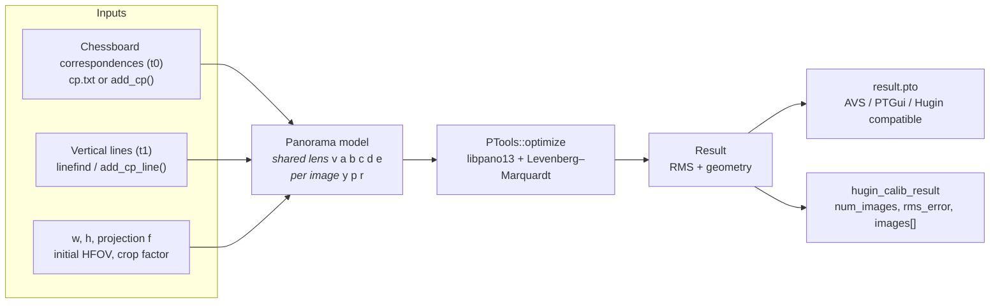
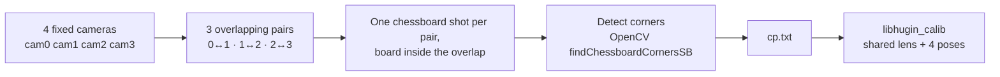

# libhugin_calib

**Multi-camera lens calibration as a C library — control points in, stitcher-ready `.pto` out.**

[](#license)
[](#changelog)
[](#requirements)
[](#quick-start)
[](#requirements)
[](#why-this-exists)

**English** · [简体中文](README.zh-CN.md)

---

Feed it correspondences between overlapping cameras. Get back **one shared lens model**
(`v/a/b/c` + principal-point offsets `d/e`) plus **per-camera pose** (`yaw/pitch/roll`) — exactly
the geometry block a panorama stitcher needs, written as an AVS / PTGui / Hugin compatible `.pto`.

The calibration engine is Hugin's optimiser (`PTools::optimize` → libpano13 → Levenberg–Marquardt),
stripped down to ~22 translation units and repackaged as a **self-contained shared library with a
pure C ABI**. No wxWidgets, no OpenGL, no ExifTool, no image decoding, no display server.

| | |
|---|---|
| **Accuracy** | `< 0.001°` agreement with Hugin GUI in its *Positions (incremental, from anchor)* mode |
| **Footprint** | 4 runtime shared libs (`libhugin_calib`, `libpano13`, `VIGRA`, `lcms2`) — copy a folder, run |
| **Integration** | one header, 18 C functions, `dlopen`-able from C / C++ / Python / Rust / Go / Java |
| **Deployment** | headless ARM boards (RK3588), x86_64 servers, containers |

**Jump to:** [Why](#why-this-exists) · [How it works](#how-it-works) · [Quick start](#quick-start) ·
[pto output](#what-you-get) · [Validation](#validation) · [API](#api-reference) ·
[Recipes](#recipes) · [Build](#building-from-source) · [Related](#related-projects) · [FAQ](#faq)

---

## Why this exists

Calibrating a ring of fisheye cameras for real-time stitching is normally a GUI chore: open Hugin,
load N images, hand-place control points, tick the right optimiser checkboxes, and copy numbers out.
That does not scale to a product that ships on an embedded board and must re-calibrate on the line.

`libhugin_calib` keeps **only** the numerics — the same lens model, the same optimiser, the same
output convention as Hugin — and exposes them as an embeddable library:

```c
hugin_calib_set_flags(h, AUTO | FIX_LENS | DISTRIBUTE);  // == Hugin GUI "Positions (incremental, from anchor)"
hugin_calib_run(h);                                      // LM optimisation, headless
hugin_calib_write_pto(h, "result.pto");                  // geometry ready for AVS / PTGui
```

### How it compares

| | libhugin_calib | Hugin GUI | OpenCV `calibrateCamera` | PTGui |
|---|---|---|---|---|
| Runs headless, embeddable | ✅ C ABI shared lib | ❌ wxWidgets GUI app | ✅ library | ❌ commercial GUI |
| One **shared** lens across all cameras | ✅ single `v/a/b/c` | ✅ | ❌ intrinsics per camera | ✅ |
| Emits stitcher-ready `.pto` | ✅ `f3 v a b c y p r` | ✅ | ❌ needs format conversion | ✅ |
| Same model/convention as panotools & AVS | ✅ byte-identical fields | ✅ | ❌ pinhole + `fx/fy/cx/cy` | ✅ |
| Constrain pose with vertical lines | ✅ built-in `linefind` (t1) | ✅ assistant | ❌ | ✅ |
| Automating N cameras in a pipeline | ✅ 20 lines of C | ❌ click-through | ⚠️ manual bookkeeping | ❌ |
| Licence / cost | GPL-2.0-or-later | GPL | Apache-2.0 | commercial |

> **Not** a replacement for intrinsic calibration of a single camera. It solves the *relative*
> problem: shared lens distortion + relative orientation of cameras that see the same scene.

---

## Features

- **One lens, many cameras** — `v/a/b/c` are linked across all images (as Hugin's shared lens
  variables), so a 4-camera rig gets a single consistent lens model plus 4 poses.
- **Hugin GUI parity, proved by numbers** — the `AUTO | FIX_LENS | DISTRIBUTE` flag trio reproduces
  *Positions (incremental, from anchor)* to `< 0.001°`; see [Validation](#validation).
- **Smart optimisation** (`SMART`) — mirrors the Hugin assistant (`autooptimiser -a`):
  incremental pairwise pre-optimisation, then a global pass that re-estimates `v/a/b/c/d/e`
  when the panorama field of view is ≥ 150°.
- **Vertical-line constraints** (`LINEFIND`) — detects near-vertical edges in each image
  (`linefind`-style) and adds them as `t1` control points, which pin down `roll`/`pitch` without
  any manual work. Reported back per image as `num_lines`.
- **Principal-point offsets** — `d`/`e` are optimised and exported, fixing straight-line bending
  at the seams of real lenses.
- **Pure C ABI** — `extern "C"`, no C++ types in the header, no exceptions across the boundary,
  opaque handle, library-owned result arrays with a single `free()`.
- **Thread-safe by construction** — one independent state object per handle, no mutable globals.
- **Zero GUI dependencies** — GPU/GL/EXIF code is compiled out; calibration is pure CPU, ~500 ms
  for a handful of control points on ARM.

---

## How it works



1. Your detector (e.g. OpenCV `findChessboardCornersSB`) produces pixel correspondences.
2. The library builds a `Panorama`, links the lens variables, and serialises to a pto script.
3. libpano13 parses it and runs LM on the selected variables until the reprojection residual converges.
4. Geometry is read back into the C result struct and/or written as an AVS-compatible `.pto`.

---

## Quick start

### Requirements

| | |
|---|---|
| OS / arch | Linux (`glibc`), aarch64 or x86_64; builds on anything with a C++11 compiler |
| Runtime | 4 shared libraries, shipped in `lib/` — nothing to install |
| Build only | `libpano13-dev`, `liblcms2-dev`, VIGRA ≥ 1.9 (`libvigraimpex-dev` on x86_64, build from source on aarch64) |
| Not required | GUI toolkit, OpenGL/EGL, EXIF, JPEG/PNG/TIFF/OpenEXR, FFTW, Boost, SQLite |

### 1. Get the library

```bash
# Prebuilt SDK (x86_64 / aarch64) — from the Releases page
unzip hugin_calib_sdk_1.2.0.zip -d /opt/hugin_calib
export LD_LIBRARY_PATH=/opt/hugin_calib/lib

# ...or build it yourself, see "Building from source"
```

### 2. Calibrate from C (20 lines)

```c
#include <stdio.h>
#include <stdlib.h>
#include "hugin_calib.h"

int main(void)
{
    hugin_calib_handle *h = hugin_calib_create();

    /* 4K full-frame fisheye, 2.95 mm, crop 4.85, 4 cameras sharing one lens */
    double hfov = hugin_calib_calc_hfov(2.95, 4.85, 3840, 2160);   /* 151.013868° */
    hugin_calib_set_images(h, 3840, 2160,
                           HUGIN_CALIB_PROJ_FULL_FRAME_FISHEYE, hfov, 4.85, 4);
    hugin_calib_load_cp_file(h, "cp.txt");

    /* == Hugin GUI "Positions (incremental, from anchor point)" */
    hugin_calib_set_flags(h, HUGIN_CALIB_FLAG_AUTO |
                             HUGIN_CALIB_FLAG_FIX_LENS |
                             HUGIN_CALIB_FLAG_DISTRIBUTE);

    if (hugin_calib_run(h) != HUGIN_CALIB_OK) {
        fprintf(stderr, "calibration failed: %s\n", hugin_calib_last_error(h));
        return 1;
    }

    hugin_calib_result r;
    hugin_calib_get_result(h, &r);
    printf("RMS = %.4f px\n", r.rms_error);
    for (int i = 0; i < r.num_images; ++i)
        printf("cam%d  v=%.6f  y=%.6f  p=%.6f  r=%.6f\n", i,
               r.images[i].v, r.images[i].yaw, r.images[i].pitch, r.images[i].roll);
    free(r.images);                       /* library allocates, caller frees */

    hugin_calib_write_pto(h, "result.pto");
    hugin_calib_destroy(h);
    return 0;
}
```

```bash
gcc app.c -I/opt/hugin_calib/include -L/opt/hugin_calib/lib -lhugin_calib -o app
export LD_LIBRARY_PATH=/opt/hugin_calib/lib && ./app
```

### 3. Calibrate from Python

```python
import ctypes

lib = ctypes.CDLL("/opt/hugin_calib/lib/libhugin_calib.so")
lib.hugin_calib_create.restype = ctypes.c_void_p
lib.hugin_calib_set_images.argtypes = [ctypes.c_void_p, ctypes.c_int, ctypes.c_int,
                                       ctypes.c_int, ctypes.c_double, ctypes.c_double,
                                       ctypes.c_int]
lib.hugin_calib_run.argtypes = [ctypes.c_void_p]

h = lib.hugin_calib_create()
lib.hugin_calib_set_images(h, 3840, 2160, 3, 151.013868, 4.85, 4)  # f3 fisheye
lib.hugin_calib_load_cp_file(h, b"cp.txt")
lib.hugin_calib_set_flags(h, 1 | 2 | 4)      # AUTO | FIX_LENS | DISTRIBUTE
print("ret =", lib.hugin_calib_run(h))
lib.hugin_calib_destroy(h)
```

A complete ctypes example, including the result struct and `free()`, is in
[`src/examples/example_python.py`](src/examples/example_python.py).

### 4. Or use the CLI driver

```bash
./hugin_calib_driver \
    --width 3840 --height 2160 --proj 3 \
    --hfov 151.013868 --crop 4.85 \
    --images 4 --cp cp.txt \
    --auto --fix-lens --distribute \
    --out result.pto
```

Run `hugin_calib_driver --help` for all 21 options (including `--smart`, `--linefind`, `--all`,
`--pano`, `--init`, `--opt`).

---

## What you get

### Control point file format

```text
# img1  x1           y1           img2  x2           y2     [type]
0      3038.158936  1024.557495  1     316.285950   997.580383
0      3117.421387  1021.515503  1     388.280273   992.575989
```

| column | meaning |
|---|---|
| `img1`, `img2` | 0-based camera indices |
| `x1, y1`, `x2, y2` | pixel coordinates of the same physical point |
| optional 7th column | `0` = point (t0, default), `1` = vertical line (t1), `2` = horizontal line |
| `#` | comment line, ignored |

### Output `.pto` (AVS / PTGui compatible)

```text
#hugin_optimizeReferenceImage 0
i w3840 h2160 f3 v151.014 a0 b0 c0 y-169.891 p0        r0        n"camera_0.jpg"
i w3840 h2160 f3 v151.014 a0 b0 c0 y-62.12   p-0.999663 r-0.383219 n"camera_1.jpg"
i w3840 h2160 f3 v151.014 a0 b0 c0 y44.9722  p0.849943  r3.53175  n"camera_2.jpg"
i w3840 h2160 f3 v151.014 a0 b0 c0 y163.697  p-3.36976  r-0.04098  n"camera_3.jpg"
```

| field | meaning |
|---|---|
| `f3` | full-frame fisheye projection (Hugin `f`-code) |
| `v` | horizontal field of view in degrees — the lens focal length in angle form |
| `a b c` | radial distortion coefficients, normalised with `r = 1` at the image corner |
| `d e` | principal point offset |
| `y p r` | per-camera yaw / pitch / roll, relative to the anchor image (image 0) |
| `w h` | image size in pixels |
| `Ra..Re`, `Eev`, `Va..Vd` | photometric fields — untouched by this library, pass them through from your own pto template |

### HFOV from focal length

Hugin (and this library) describe a lens by **field of view in degrees**, not by millimetres.
For a full-frame fisheye:

$$
d_{\text{sensor}} = \frac{\sqrt{36^2+24^2}}{\text{crop}},\qquad
w_{\text{sensor}} = \frac{d_{\text{sensor}}}{\sqrt{1 + (h/w)^2}},\qquad
\text{HFOV} = \frac{w_{\text{sensor}}}{f}\cdot\frac{180}{\pi}
$$

For `f = 2.95 mm`, `crop = 4.85`, `3840×2160` this yields `151.013868°`.
Or just call `hugin_calib_calc_hfov(2.95, 4.85, 3840, 2160)`.

Pixel focal length for a full-frame fisheye: $f_{px} \approx \dfrac{W \cdot 180}{v \pi}$
(e.g. `v = 151.01°`, `W = 3840` → ≈ 1457 px).

---

## Validation

### Parity with Hugin GUI

Same input (3 cameras, 15 control points, 4K full-frame fisheye, `--auto --fix-lens --distribute`),
compared against a `.pto` produced by the Hugin GUI in *Positions (incremental, from anchor point)*:

| | Hugin GUI | libhugin_calib | Δ |
|---|---|---|---|
| cam0 | `y=-113.260401 p=0 r=0` | `y=-113.260401 p=0 r=0` | anchor |
| cam1 | `y=-10.579829 p=-1.197485 r=-0.403391` | `y=-10.579829 p=-1.197485 r=-0.403391` | `< 0.001°` |
| cam2 | `y=92.712462 p=1.147191 r=-1.437652` | `y=92.712462 p=1.147190 r=-1.437651` | `< 0.001°` |
| lens | `v=151.014 a=0 b=0 c=0` | `v=151.014 a=0 b=0 c=0` | identical |

Three independent tools agree on the generated script: the driver itself, the reference
`PToptimizer` from libpano13, and a direct `ParseScript`/`RunLMOptimizer` harness
(`verify_pto`). The official `.pto` in that dataset carries *hand-set ideal* poses
(initial RMS 84.86 px); the optimiser brings it to 6.68 px.

### Real data

| Test | Result |
|---|---|
| Real 4K fisheye chessboard set (3–4 cameras, 7×4 corners) | RMS ≈ 5.6 px — the control-point noise floor |
| Shared lens linkage | all cameras report a single identical `v/a/b/c` |
| Synthetic rectilinear poses | yaw recovered within 2–3°, HFOV within ~6 % (pure 2-D FOV/pose coupling) |
| Robustness | RMS convergence from 160 px → 0.5–10 px depending on control point quality |
| Build | clean native aarch64 ELF, reproducible on RK3588 with no GUI stack |

Method, caveats and the full alignment analysis:
[docs index](docs/README.md).

---

## API reference

One header: [`src/api/hugin_calib.h`](src/api/hugin_calib.h). All functions return a
`hugin_calib_status` unless noted. The handle is opaque; a single handle is not shared between
threads, but distinct handles are fully independent.

### Lifecycle

```c
hugin_calib_handle *hugin_calib_create(void);
void hugin_calib_destroy(hugin_calib_handle *h);          /* NULL-safe */
```

### Configuration

```c
int hugin_calib_set_images(h, int width, int height, int proj,
                           double hfov, double crop, int num_images);   /* num_images >= 2 */
int hugin_calib_set_initial_pose(h, int idx, double yaw, double pitch, double roll);
int hugin_calib_load_initial_poses(h, const char *filename);  /* "yaw pitch roll" per line */
int hugin_calib_set_flags(h, int flags);                      /* OR of hugin_calib_flags */
int hugin_calib_set_optimize_vars(h, int idx, const char *vars);  /* e.g. "y,p,r" */
```

### Control points

```c
int hugin_calib_add_cp(h, int img1, double x1, double y1,
                          int img2, double x2, double y2);        /* cross-image point (t0) */
int hugin_calib_add_cp_line(h, int img, double x1, double y1,
                                       double x2, double y2);     /* in-image vertical line (t1) */
int hugin_calib_enable_linefind(h, const char *imgdir, int lines);  /* auto-detect verticals */
int hugin_calib_load_cp_file(h, const char *filename);
int hugin_calib_get_num_cp(const hugin_calib_handle *h);
```

### Execute & read back

```c
int hugin_calib_run(h);
int hugin_calib_get_result(const hugin_calib_handle *h, hugin_calib_result *out);
int hugin_calib_write_pto(const hugin_calib_handle *h, const char *filename);
const char *hugin_calib_last_error(const hugin_calib_handle *h);
```

```c
typedef struct hugin_calib_image_result {
    int    width, height, projection;
    double v, a, b, c;          /* shared lens model */
    double d, e;                /* principal point offsets (px) */
    double yaw, pitch, roll;    /* degrees, relative to image 0 */
    int    num_lines;           /* vertical lines found by linefind (0 if disabled) */
    char   filename[256];
} hugin_calib_image_result;

typedef struct hugin_calib_result {
    int    num_images;
    double rms_error;                    /* reprojection RMS in px */
    hugin_calib_image_result *images;    /* library-allocated: free(result.images) */
} hugin_calib_result;
```

### Utilities

```c
double      hugin_calib_calc_hfov(double focal_mm, double crop_factor, int width, int height);
const char *hugin_calib_version(void);   /* "1.2.0" */
```

### Projections (`hugin_calib_projection`)

| value | name | typical use |
|---|---|---|
| `0` | `RECTILINEAR` | pinhole / perspective |
| `1` | `PANORAMIC` | cylindrical |
| `2` | `CIRCULAR_FISHEYE` | circular fisheye |
| **`3`** | **`FULL_FRAME_FISHEYE`** | **4K action/fisheye cameras (AVS default)** |
| `4` | `EQUIRECTANGULAR` | equirectangular |
| `8` | `FISHEYE_ORTHOGRAPHIC` | orthographic fisheye |
| `10` | `FISHEYE_STEREOGRAPHIC` | stereographic fisheye |
| `20` | `FISHEYE_THOBY` | Thoby fisheye |
| `21` | `FISHEYE_EQUISOLID` | equisolid-angle fisheye |

### Flags (`hugin_calib_flags`)

| flag | value | effect |
|---|---|---|
| `HUGIN_CALIB_FLAG_AUTO` | `1` | incremental pairwise pre-optimisation (Hugin *Positions (incremental)*) |
| `HUGIN_CALIB_FLAG_FIX_LENS` | `2` | keep `v/a/b/c` fixed, optimise pose only |
| `HUGIN_CALIB_FLAG_DISTRIBUTE` | `4` | spread initial yaw evenly (Hugin `DistributeImagesCmd`) |
| `HUGIN_CALIB_FLAG_LINEFIND` | `8` | detect vertical lines and add `t1` control points |
| `HUGIN_CALIB_FLAG_SMART` | `16` | SmartOptimise: `autooptimiser -a` equivalent, may re-estimate `v/a/b/c/d/e` |

Recommended combinations:

```c
/* Hugin GUI "Positions (incremental, from anchor point)" — lens locked */
AUTO | FIX_LENS | DISTRIBUTE

/* Hugin assistant "Align" — full lens + pose calibration */
SMART | LINEFIND
```

> `SMART` and `FIX_LENS` are contradictory: SmartOptimise decides for itself whether to move
> `v/a/b/c/d/e`. Do not use them together.

### Status codes

| value | name | meaning |
|---|---|---|
| `0` | `HUGIN_CALIB_OK` | success |
| `-1` | `HUGIN_CALIB_ERR_NULL` | NULL argument |
| `-2` | `HUGIN_CALIB_ERR_INVALID` | invalid parameter (e.g. `num_images < 2`) |
| `-3` | `HUGIN_CALIB_ERR_CP_FILE` | control point file cannot be opened |
| `-4` | `HUGIN_CALIB_ERR_NO_CP` | no valid control points |
| `-5` | `HUGIN_CALIB_ERR_OPTIMIZE` | optimiser failed (non-zero from `PTools::optimize`) |
| `-6` | `HUGIN_CALIB_ERR_WRITE` | output file cannot be written |
| `-7` | `HUGIN_CALIB_ERR_INIT_FILE` | initial pose file cannot be opened |
| `-8` | `HUGIN_CALIB_ERR_NOT_RUN` | `get_result()` before `run()` |

---

## Recipes

### A ring of fisheye cameras (the common case)

You do **not** need to trigger all cameras simultaneously, and you do not need one photo per camera.
Hugin-style optimisation only consumes control point coordinates, not pixels.



Practical notes:

- Keep the rig mechanically fixed between shots; only the board moves.
- Use a 7×4 inner-corner board filling as much of the overlap as possible.
- Order corners identically in both cameras — a symmetric board can be flipped, silently
  producing crossed control points. Verify with a colour/asymmetry check (we use the board's
  top-left cell colour). See [`CHESSBOARD_CORNER_ALIGNMENT.md`](CHESSBOARD_CORNER_ALIGNMENT.md).
- Feed a realistic initial HFOV; the FOV/pose scale ambiguity is the main source of local minima.

### Adding vertical lines (v1.1.0+)

When the scene contains true verticals (door frames, poles, building edges), let `linefind`
constrain `roll`/`pitch` per camera:

```bash
./hugin_calib_driver \
    --width 3840 --height 2160 --proj 3 \
    --hfov 151.013868 --crop 4.85 \      # crop factor must be correct!
    --images 3 --cp cp.txt \
    --imgdir /path/to/images \
    --linefind --lines 10 \
    --smart \
    --out result.pto
```

```c
hugin_calib_enable_linefind(h, "/path/to/images", 10);
hugin_calib_set_flags(h, HUGIN_CALIB_FLAG_SMART | HUGIN_CALIB_FLAG_LINEFIND);
hugin_calib_run(h);
/* result.images[i].num_lines = verticals actually used for image i */
```

Gotchas:

- `crop` must match the real sensor, otherwise the focal-length fit used by the line detector fails.
- Lines must be genuinely vertical, high-contrast, > 20 px long, ≥ 80 px apart.
- Vertical lines constrain `roll`/`pitch` only — you still need point correspondences for yaw/HFOV.
- `SMART` re-estimates HFOV when the panorama FOV ≥ 150°, so `v` may legitimately move
  (e.g. 151° → 133°) together with `b/d/e`.

Full guide: [`LINEFIND_SMART_GUIDE.md`](LINEFIND_SMART_GUIDE.md).

---

## Building from source

```bash
# 1. System dependencies
sudo apt install -y libpano13-dev liblcms2-dev
#    x86_64 also has libvigraimpex-dev; on aarch64 VIGRA must be built from source:
#    see docs/README.md → "Building on aarch64"

# 2. Configure & build
cmake -S . -B build        # add -DVIGRA_ROOT=/opt/vigra if VIGRA is installed elsewhere
cmake --build build -j4

# 3. Package a self-contained distribution (libs + header + binaries + examples)
./package.sh build dist
```

Artifacts:

| path | what |
|---|---|
| `build/libhugin_calib.so` | the shared library (C API) |
| `build/hugin_calib_driver` | CLI calibration driver |
| `build/verify_pto` | pto optimizer harness (validation) |
| `build/example_c`, `build/example_cpp` | compiled examples |
| `dist/` | relocatable bundle: `lib/`, `include/`, `bin/`, `examples/`, docs |

Debugging helper: set `HUGIN_DUMP_SCRIPT=<file>` to dump the exact pto script handed to
libpano13.

---

## Documentation

| Document | Language | Contents |
|---|---|---|
| [docs/README.md](docs/README.md) | EN | documentation index & reading paths |
| [README.zh-CN.md](README.zh-CN.md) | 中文 | this README in Simplified Chinese |
| [DOCUMENTATION.md](DOCUMENTATION.md) | 中文 | lens model, optimiser internals, AVS integration, pitfalls |
| [HUGIN_GUI_ALIGNMENT.md](HUGIN_GUI_ALIGNMENT.md) | 中文 | source-level analysis of the three Hugin GUI behaviours reproduced here |
| [LINEFIND_SMART_GUIDE.md](LINEFIND_SMART_GUIDE.md) | 中文 | vertical-line detection and Smart optimise, with API/CLI examples |
| [CHESSBOARD_CORNER_ALIGNMENT.md](CHESSBOARD_CORNER_ALIGNMENT.md) | 中文 | avoiding mirrored/crossed chessboard control points |

Deep-dive documents are currently Simplified Chinese; English translations are welcome
(see [Contributing](#contributing)).

---

## Related projects

Neighbouring tools, and when to pick them instead:

| Project | Scope | Difference from this library |
|---|---|---|
| [MC-Calib](https://github.com/rameau-fr/MC-Calib) · MIT, C++/OpenCV/Ceres | generic multi-camera rig calibration: Charuco targets, overlapping **or non-overlapping** cameras, Brown/Kannala models, metric intrinsics + 4×4 extrinsics, YAML output | offline toolbox with **per-camera** intrinsics and translations; no shared pano lens model, no `.pto`, not an embeddable C library |
| [Hugin](https://hugin.sourceforge.io/) | panorama stitcher whose optimiser this library embeds | GUI-first; the same numerics are exposed here headless |
| [libpano13](https://sourceforge.net/projects/panotools/) | projection math + LM optimiser used internally | low-level; no rig abstraction and no calibration C API |
| [OpenCV](https://opencv.org/) | `calibrateCamera`, `stereoCalibrate`, corner detection | per-camera pinhole intrinsics; rig bookkeeping and pto export are yours |
| [PTGui](https://www.ptgui.com/) | commercial panorama stitcher with calibration | commercial GUI; not embeddable |

Rule of thumb: pick **MC-Calib** when you need metric translations and per-camera
intrinsics (sensor fusion, ROS, depth); pick **libhugin_calib** when you need a
single shared lens and a stitching-ready `.pto` inside your own process.

---

## FAQ

**`libpano13.so.3: cannot open shared object file`**
`export LD_LIBRARY_PATH=/opt/hugin_calib/lib` before running, or add an `rpath` when linking.

**Can I link it statically?**
`libhugin_calib.so` already contains all of `huginbase` statically. Switching the target to
`STATIC` in CMake works, but libpano13/VIGRA/lcms2 remain dynamic dependencies.

**The RMS is large — where do I look?**
1. Are point correspondences actually the same physical point in both images (no mirrored board)?
2. Is the initial HFOV realistic? Use `hugin_calib_calc_hfov`.
3. Do control points cover the frame edges as well as the centre?
4. Are you mixing `FIX_LENS` with `SMART`?

**Why does `v` change when I enable `SMART`?**
That is the Hugin assistant behaviour: with a panorama FOV ≥ 150° it re-calibrates HFOV and
distortion instead of trusting your initial value.

**How many cameras are supported?**
Any N ≥ 2. Cameras without control points keep their initial pose.

**Does it read image files?**
Only the line detector does (`--linefind` / `hugin_calib_enable_linefind`), and only to extract
edges. Corner detection is your job — any detector works, as long as you emit a `cp.txt`.

**Is it thread-safe?**
Yes across handles. Use one handle per thread; do not call two functions on the same handle
concurrently.

---

## Contributing

Issues and pull requests are welcome. Useful first contributions:

- English translations of the Chinese deep-dive docs under `docs/`.
- Bindings (`pybind11`, Rust `bindgen`, Go cgo) — the header is already C99-clean.
- Detector integrations (chessboard, ChArUco, AprilTag) producing `cp.txt`.
- Reports from other boards/arches — mention toolchain, libpano13 version and RMS.

Please include the pto script (`HUGIN_DUMP_SCRIPT`) and a minimal control-point file when
reporting optimiser problems.

---

## Contributors

<a href="https://github.com/zksite/hugin-mini/graphs/contributors">
  
</a>

Maintained by [@zksite](https://github.com/zksite). Bug reports, translations, bindings and
detector integrations are all welcome — see [Contributing](#contributing).

---

## Changelog

| Version | Changes |
|---|---|
| 1.2.0 | `num_lines` per image in the result struct; vertical-line budget 5 → 10 |
| 1.1.0 | `LINEFIND` / `SMART` flags, `enable_linefind()`, `add_cp_line()`, `d`/`e` in results |
| 1.0.0 | first C ABI release: shared lens calibration, `AUTO`/`FIX_LENS`/`DISTRIBUTE` parity with Hugin GUI |

---

## License

**GPL-2.0-or-later.** See [LICENSE](LICENSE).

This library is derived from [Hugin](https://hugin.sourceforge.io/) and links against
[libpano13](https://sourceforge.net/projects/panotools/); both are GPL-2.0-or-later, so derivative
works must stay GPL-compatible. If you need to ship it inside a proprietary product, the usual
options are process isolation or a separate agreement — open an issue to discuss.

Bundled / required third-party components:

| component | licence | role |
|---|---|---|
| Hugin (`huginbase`, trimmed) | GPL-2.0-or-later | panorama model, pto serialisation |
| libpano13 | GPL-2.0-or-later | projection math, LM optimiser |
| VIGRA | MIT | basic image/geometry types |
| lcms2 | MIT | ICC colour management (used by `utils`) |

---

<sub>Keywords: fisheye calibration, multi-camera calibration, panorama stitching, Hugin,
libpano13, pto, shared lens model, headless, embedded Linux, RK3588.</sub>
