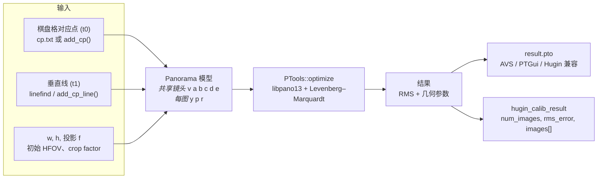
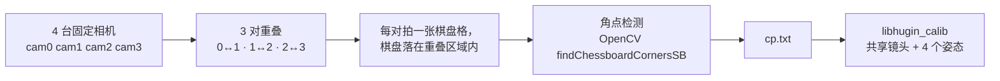

# libhugin_calib

**多相机共享镜头标定，封装成 C 动态库 —— 输入控制点，输出可直接拼接的 `.pto`。**

[](#许可证)
[](#版本记录)
[](#环境要求)
[](#快速开始)
[](#环境要求)
[](#为什么需要它)

[English](README.md) · **简体中文**

---

喂给它重叠相机之间的对应点，返回**一个共享镜头模型**（`v/a/b/c` + 主点偏移 `d/e`）和
**每台相机的姿态**（`yaw/pitch/roll`）—— 这正是全景拼接器需要的几何块，输出为
AVS / PTGui / Hugin 兼容的 `.pto`。

标定引擎来自 Hugin 的优化器（`PTools::optimize` → libpano13 → Levenberg–Marquardt），
裁剪到约 22 个编译单元，重新封装成**纯 C ABI 的自包含动态库**。没有 wxWidgets、没有
OpenGL、没有 ExifTool、不解码图像、不需要显示服务器。

| | |
|---|---|
| **精度** | 与 Hugin GUI 的 *位置（增量，从锚定点开始）* 模式一致性 `< 0.001°` |
| **体积** | 4 个运行时动态库（`libhugin_calib`、`libpano13`、`VIGRA`、`lcms2`）—— 复制目录即可运行 |
| **集成** | 一个头文件、18 个 C 函数，可从 C / C++ / Python / Rust / Go / Java 通过 `dlopen` 调用 |
| **部署** | 无头 ARM 板（RK3588）、x86_64 服务器、容器 |

**跳转：** [为什么需要它](#为什么需要它) · [工作原理](#工作原理) · [快速开始](#快速开始) ·
[输出内容](#输出内容) · [验证](#验证) · [API 参考](#api-参考) ·
[实战方案](#实战方案) · [从源码构建](#从源码构建) · [相关项目](#相关项目) · [常见问题](#常见问题)

---

## 为什么需要它

为一圈鱼眼相机做实时拼接标定，通常是一件 GUI 苦力活：打开 Hugin、载入 N 张图、手工点控制点、
勾选正确的优化器选项、再把数字抄出来。这种方式无法规模化到一块嵌入式板卡上的产品，
更无法在产线上重复标定。

`libhugin_calib` **只保留数值部分** —— 相同的镜头模型、相同的优化器、相同的输出约定 ——
并把它暴露为可嵌入的库：

```c
hugin_calib_set_flags(h, AUTO | FIX_LENS | DISTRIBUTE);  // == Hugin GUI "位置（增量，从锚定点开始）"
hugin_calib_run(h);                                      // LM 优化，无头运行
hugin_calib_write_pto(h, "result.pto");                  // 几何结果可直接交给 AVS / PTGui
```

### 与其他方案对比

| | libhugin_calib | Hugin GUI | OpenCV `calibrateCamera` | PTGui |
|---|---|---|---|---|
| 无头运行、可嵌入 | ✅ C ABI 动态库 | ❌ wxWidgets GUI 程序 | ✅ 库 | ❌ 商业 GUI |
| 所有相机**共享**一个镜头 | ✅ 单一 `v/a/b/c` | ✅ | ❌ 每相机独立内参 | ✅ |
| 直接输出拼接器可用的 `.pto` | ✅ `f3 v a b c y p r` | ✅ | ❌ 需自行转换格式 | ✅ |
| 与 panotools / AVS 模型和约定一致 | ✅ 字段完全一致 | ✅ | ❌ 针孔 + `fx/fy/cx/cy` | ✅ |
| 用垂直线约束姿态 | ✅ 内置 `linefind`（t1） | ✅ 助手 | ❌ | ✅ |
| 流水线中自动处理 N 路相机 | ✅ 20 行 C | ❌ 手工点击 | ⚠️ 需自行管理 | ❌ |
| 许可证 / 成本 | GPL-2.0-or-later | GPL | Apache-2.0 | 商业 |

> **不是**单相机内参标定的替代品。它解决的是*相对*问题：共享的镜头畸变 + 看到同一场景的
> 相机之间的相对姿态。

---

## 特性

- **一个镜头，多台相机** —— `v/a/b/c` 在所有图像间联动（等价于 Hugin 的共享镜头变量），
  因此 4 路相机机架只需标定出一致的镜头模型 + 4 个姿态。
- **用数字证明与 Hugin GUI 等价** —— `AUTO | FIX_LENS | DISTRIBUTE` 三标志组合可以复现
  *位置（增量，从锚定点开始）* 到 `< 0.001°`；见[验证](#验证)。
- **Smart 优化**（`SMART`）—— 对应 Hugin 助手（`autooptimiser -a`）：先做增量式两两预优化，
  当全景视场 ≥ 150° 时再做一次全局优化，重新估计 `v/a/b/c/d/e`。
- **垂直线约束**（`LINEFIND`）—— 在每张图中检测近垂直边缘（`linefind` 风格），作为 `t1`
  控制点加入，无需人工即可约束 `roll`/`pitch`。结果中按图返回 `num_lines`。
- **主点偏移** —— `d`/`e` 参与优化并导出，修正真实镜头在拼接缝处的直线弯曲。
- **纯 C ABI** —— `extern "C"`，头文件无 C++ 类型，异常不跨越边界，句柄不透明，
  结果数组由库分配、一次 `free()` 释放。
- **天生线程安全** —— 每个句柄一份独立状态，无全局可变变量。
- **零 GUI 依赖** —— GPU/GL/EXIF 代码在编译期移除；标定纯 CPU，在 ARM 上处理少量控制点约 500 ms。

---

## 工作原理



1. 你的检测器（例如 OpenCV `findChessboardCornersSB`）产生像素对应点。
2. 库构建 `Panorama`，联动镜头变量，并序列化为 pto 脚本。
3. libpano13 解析脚本并在选定变量上跑 LM，直到重投影残差收敛。
4. 几何参数读回 C 结果结构体，和/或写成 AVS 兼容的 `.pto`。

---

## 快速开始

### 环境要求

| | |
|---|---|
| 操作系统 / 架构 | Linux（`glibc`），aarch64 或 x86_64；任何有 C++11 编译器的平台均可构建 |
| 运行时 | `lib/` 中附带 4 个动态库 —— 无需安装 |
| 仅构建时 | `libpano13-dev`、`liblcms2-dev`、VIGRA ≥ 1.9（x86_64 有 `libvigraimpex-dev`，aarch64 需源码编译） |
| 不需要 | GUI 工具包、OpenGL/EGL、EXIF、JPEG/PNG/TIFF/OpenEXR、FFTW、Boost、SQLite |

### 1. 获取库

```bash
# 预编译 SDK（x86_64 / aarch64）—— 见 Releases 页面
unzip hugin_calib_sdk_1.2.0.zip -d /opt/hugin_calib
export LD_LIBRARY_PATH=/opt/hugin_calib/lib

# ……或者自行构建，见"从源码构建"
```

### 2. 用 C 标定（20 行）

```c
#include <stdio.h>
#include <stdlib.h>
#include "hugin_calib.h"

int main(void)
{
    hugin_calib_handle *h = hugin_calib_create();

    /* 4K 全帧鱼眼，2.95 mm，crop 4.85，4 路相机共用一个镜头 */
    double hfov = hugin_calib_calc_hfov(2.95, 4.85, 3840, 2160);   /* 151.013868° */
    hugin_calib_set_images(h, 3840, 2160,
                           HUGIN_CALIB_PROJ_FULL_FRAME_FISHEYE, hfov, 4.85, 4);
    hugin_calib_load_cp_file(h, "cp.txt");

    /* == Hugin GUI "位置（增量，从锚定点开始）" */
    hugin_calib_set_flags(h, HUGIN_CALIB_FLAG_AUTO |
                             HUGIN_CALIB_FLAG_FIX_LENS |
                             HUGIN_CALIB_FLAG_DISTRIBUTE);

    if (hugin_calib_run(h) != HUGIN_CALIB_OK) {
        fprintf(stderr, "calibration failed: %s\n", hugin_calib_last_error(h));
        return 1;
    }

    hugin_calib_result r;
    hugin_calib_get_result(h, &r);
    printf("RMS = %.4f px\n", r.rms_error);
    for (int i = 0; i < r.num_images; ++i)
        printf("cam%d  v=%.6f  y=%.6f  p=%.6f  r=%.6f\n", i,
               r.images[i].v, r.images[i].yaw, r.images[i].pitch, r.images[i].roll);
    free(r.images);                       /* 库分配，调用方释放 */

    hugin_calib_write_pto(h, "result.pto");
    hugin_calib_destroy(h);
    return 0;
}
```

```bash
gcc app.c -I/opt/hugin_calib/include -L/opt/hugin_calib/lib -lhugin_calib -o app
export LD_LIBRARY_PATH=/opt/hugin_calib/lib && ./app
```

### 3. 用 Python 标定

```python
import ctypes

lib = ctypes.CDLL("/opt/hugin_calib/lib/libhugin_calib.so")
lib.hugin_calib_create.restype = ctypes.c_void_p
lib.hugin_calib_set_images.argtypes = [ctypes.c_void_p, ctypes.c_int, ctypes.c_int,
                                       ctypes.c_int, ctypes.c_double, ctypes.c_double,
                                       ctypes.c_int]
lib.hugin_calib_run.argtypes = [ctypes.c_void_p]

h = lib.hugin_calib_create()
lib.hugin_calib_set_images(h, 3840, 2160, 3, 151.013868, 4.85, 4)  # f3 鱼眼
lib.hugin_calib_load_cp_file(h, b"cp.txt")
lib.hugin_calib_set_flags(h, 1 | 2 | 4)      # AUTO | FIX_LENS | DISTRIBUTE
print("ret =", lib.hugin_calib_run(h))
lib.hugin_calib_destroy(h)
```

包含结果结构体和 `free()` 的完整 ctypes 示例见
[`src/examples/example_python.py`](src/examples/example_python.py)。

### 4. 或使用命令行工具

```bash
./hugin_calib_driver \
    --width 3840 --height 2160 --proj 3 \
    --hfov 151.013868 --crop 4.85 \
    --images 4 --cp cp.txt \
    --auto --fix-lens --distribute \
    --out result.pto
```

运行 `hugin_calib_driver --help` 查看全部 21 个选项（包括 `--smart`、`--linefind`、`--all`、
`--pano`、`--init`、`--opt`）。

---

## 输出内容

### 控制点文件格式

```text
# img1  x1           y1           img2  x2           y2     [type]
0      3038.158936  1024.557495  1     316.285950   997.580383
0      3117.421387  1021.515503  1     388.280273   992.575989
```

| 列 | 含义 |
|---|---|
| `img1`, `img2` | 从 0 开始的相机索引 |
| `x1, y1`, `x2, y2` | 同一物理点在两图中的像素坐标 |
| 可选第 7 列 | `0` = 点（t0，默认），`1` = 垂直线（t1），`2` = 水平线 |
| `#` | 注释行，忽略 |

### 输出 `.pto`（AVS / PTGui 兼容）

```text
#hugin_optimizeReferenceImage 0
i w3840 h2160 f3 v151.014 a0 b0 c0 y-169.891 p0        r0        n"camera_0.jpg"
i w3840 h2160 f3 v151.014 a0 b0 c0 y-62.12   p-0.999663 r-0.383219 n"camera_1.jpg"
i w3840 h2160 f3 v151.014 a0 b0 c0 y44.9722  p0.849943  r3.53175  n"camera_2.jpg"
i w3840 h2160 f3 v151.014 a0 b0 c0 y163.697  p-3.36976  r-0.04098  n"camera_3.jpg"
```

| 字段 | 含义 |
|---|---|
| `f3` | 全帧鱼眼投影（Hugin `f` 编码） |
| `v` | 水平视场角（度）—— 镜头焦距的角度形式 |
| `a b c` | 径向畸变系数，归一化方式为图像角处 `r = 1` |
| `d e` | 主点偏移 |
| `y p r` | 每台相机相对锚定图像（image 0）的 yaw / pitch / roll |
| `w h` | 图像像素尺寸 |
| `Ra..Re`、`Eev`、`Va..Vd` | 光度字段 —— 本库不修改，可原样透传你自己的 pto 模板 |

### 由焦距计算 HFOV

Hugin（以及本库）用**视场角度**而不是毫米来描述镜头。对全帧鱼眼：

$$
d_{\text{sensor}} = \frac{\sqrt{36^2+24^2}}{\text{crop}},\qquad
w_{\text{sensor}} = \frac{d_{\text{sensor}}}{\sqrt{1 + (h/w)^2}},\qquad
\text{HFOV} = \frac{w_{\text{sensor}}}{f}\cdot\frac{180}{\pi}
$$

对 `f = 2.95 mm`、`crop = 4.85`、`3840×2160`，得到 `151.013868°`。
或直接调用 `hugin_calib_calc_hfov(2.95, 4.85, 3840, 2160)`。

全帧鱼眼的像素焦距：$f_{px} \approx \dfrac{W \cdot 180}{v \pi}$
（例如 `v = 151.01°`、`W = 3840` → 约 1457 px）。

---

## 验证

### 与 Hugin GUI 一致

相同输入（3 路相机、15 个控制点、4K 全帧鱼眼、`--auto --fix-lens --distribute`），
对比 Hugin GUI 在 *位置（增量，从锚定点开始）* 模式下生成的 `.pto`：

| | Hugin GUI | libhugin_calib | Δ |
|---|---|---|---|
| cam0 | `y=-113.260401 p=0 r=0` | `y=-113.260401 p=0 r=0` | 锚定 |
| cam1 | `y=-10.579829 p=-1.197485 r=-0.403391` | `y=-10.579829 p=-1.197485 r=-0.403391` | `< 0.001°` |
| cam2 | `y=92.712462 p=1.147191 r=-1.437652` | `y=92.712462 p=1.147190 r=-1.437651` | `< 0.001°` |
| 镜头 | `v=151.014 a=0 b=0 c=0` | `v=151.014 a=0 b=0 c=0` | 完全一致 |

三个独立工具对生成的脚本给出一致结果：driver 本身、libpano13 的参考 `PToptimizer`，
以及直接调用 `ParseScript`/`RunLMOptimizer` 的验证工具（`verify_pto`）。该数据集中的官方
`.pto` 带的是**手工设定的理想**姿态（初始 RMS 84.86 px），优化器把它收敛到 6.68 px。

### 实测数据

| 测试 | 结果 |
|---|---|
| 真实 4K 鱼眼棋盘格数据集（3–4 路相机，7×4 角点） | RMS ≈ 5.6 px —— 控制点噪声下限 |
| 共享镜头联动 | 所有相机输出同一个 `v/a/b/c` |
| 合成直线投影姿态 | yaw 恢复到 2–3° 以内，HFOV 约 6% 以内（纯二维 FOV/姿态耦合） |
| 鲁棒性 | 视控制点质量，RMS 从 160 px 收敛到 0.5–10 px |
| 构建 | 原生 aarch64 ELF，在 RK3588 上可复现，无 GUI 依赖栈 |

方法、局限与完整的对齐分析见 [docs 索引](docs/README.md)。

---

## API 参考

一个头文件：[`src/api/hugin_calib.h`](src/api/hugin_calib.h)。除特别说明外，所有函数返回
`hugin_calib_status`。句柄不透明；同一句柄不可跨线程共享，不同句柄完全独立。

### 生命周期

```c
hugin_calib_handle *hugin_calib_create(void);
void hugin_calib_destroy(hugin_calib_handle *h);          /* NULL 安全 */
```

### 配置

```c
int hugin_calib_set_images(h, int width, int height, int proj,
                           double hfov, double crop, int num_images);   /* num_images >= 2 */
int hugin_calib_set_initial_pose(h, int idx, double yaw, double pitch, double roll);
int hugin_calib_load_initial_poses(h, const char *filename);  /* 每行 "yaw pitch roll" */
int hugin_calib_set_flags(h, int flags);                      /* hugin_calib_flags 按位或 */
int hugin_calib_set_optimize_vars(h, int idx, const char *vars);  /* 例如 "y,p,r" */
```

### 控制点

```c
int hugin_calib_add_cp(h, int img1, double x1, double y1,
                          int img2, double x2, double y2);        /* 跨图点 (t0) */
int hugin_calib_add_cp_line(h, int img, double x1, double y1,
                                       double x2, double y2);     /* 图内垂直线 (t1) */
int hugin_calib_enable_linefind(h, const char *imgdir, int lines);  /* 自动检测垂直线 */
int hugin_calib_load_cp_file(h, const char *filename);
int hugin_calib_get_num_cp(const hugin_calib_handle *h);
```

### 执行与读回

```c
int hugin_calib_run(h);
int hugin_calib_get_result(const hugin_calib_handle *h, hugin_calib_result *out);
int hugin_calib_write_pto(const hugin_calib_handle *h, const char *filename);
const char *hugin_calib_last_error(const hugin_calib_handle *h);
```

```c
typedef struct hugin_calib_image_result {
    int    width, height, projection;
    double v, a, b, c;          /* 共享镜头模型 */
    double d, e;                /* 主点偏移（像素） */
    double yaw, pitch, roll;    /* 度，相对 image 0 */
    int    num_lines;           /* linefind 检出的垂线数（未启用为 0） */
    char   filename[256];
} hugin_calib_image_result;

typedef struct hugin_calib_result {
    int    num_images;
    double rms_error;                    /* 重投影 RMS（像素） */
    hugin_calib_image_result *images;    /* 库分配：free(result.images) */
} hugin_calib_result;
```

### 工具函数

```c
double      hugin_calib_calc_hfov(double focal_mm, double crop_factor, int width, int height);
const char *hugin_calib_version(void);   /* "1.2.0" */
```

### 投影类型（`hugin_calib_projection`）

| 值 | 名称 | 典型用途 |
|---|---|---|
| `0` | `RECTILINEAR` | 针孔 / 透视 |
| `1` | `PANORAMIC` | 柱面 |
| `2` | `CIRCULAR_FISHEYE` | 圆形鱼眼 |
| **`3`** | **`FULL_FRAME_FISHEYE`** | **4K 运动/鱼眼相机（AVS 默认）** |
| `4` | `EQUIRECTANGULAR` | 等距柱状 |
| `8` | `FISHEYE_ORTHOGRAPHIC` | 正交鱼眼 |
| `10` | `FISHEYE_STEREOGRAPHIC` | 立体投影鱼眼 |
| `20` | `FISHEYE_THOBY` | Thoby 鱼眼 |
| `21` | `FISHEYE_EQUISOLID` | 等立体角鱼眼 |

### 标志位（`hugin_calib_flags`）

| 标志 | 值 | 作用 |
|---|---|---|
| `HUGIN_CALIB_FLAG_AUTO` | `1` | 增量式两两预优化（Hugin *位置（增量）*） |
| `HUGIN_CALIB_FLAG_FIX_LENS` | `2` | 固定 `v/a/b/c`，只优化姿态 |
| `HUGIN_CALIB_FLAG_DISTRIBUTE` | `4` | 均匀分布初始 yaw（Hugin `DistributeImagesCmd`） |
| `HUGIN_CALIB_FLAG_LINEFIND` | `8` | 检测垂直线并添加 `t1` 控制点 |
| `HUGIN_CALIB_FLAG_SMART` | `16` | SmartOptimise：等价 `autooptimiser -a`，可能重新估计 `v/a/b/c/d/e` |

推荐组合：

```c
/* Hugin GUI "位置（增量，从锚定点开始）" —— 镜头锁定 */
AUTO | FIX_LENS | DISTRIBUTE

/* Hugin 助手 "对齐" —— 完整镜头 + 姿态标定 */
SMART | LINEFIND
```

> `SMART` 与 `FIX_LENS` 语义冲突：SmartOptimise 自行决定是否移动 `v/a/b/c/d/e`，不要同时使用。

### 返回码

| 值 | 名称 | 含义 |
|---|---|---|
| `0` | `HUGIN_CALIB_OK` | 成功 |
| `-1` | `HUGIN_CALIB_ERR_NULL` | 空指针参数 |
| `-2` | `HUGIN_CALIB_ERR_INVALID` | 参数非法（例如 `num_images < 2`） |
| `-3` | `HUGIN_CALIB_ERR_CP_FILE` | 控制点文件无法打开 |
| `-4` | `HUGIN_CALIB_ERR_NO_CP` | 无有效控制点 |
| `-5` | `HUGIN_CALIB_ERR_OPTIMIZE` | 优化失败（`PTools::optimize` 返回非零） |
| `-6` | `HUGIN_CALIB_ERR_WRITE` | 输出文件无法写入 |
| `-7` | `HUGIN_CALIB_ERR_INIT_FILE` | 初始姿态文件无法打开 |
| `-8` | `HUGIN_CALIB_ERR_NOT_RUN` | 在 `run()` 之前调用了 `get_result()` |

---

## 实战方案

### 一圈鱼眼相机（最常见场景）

你**不需要**所有相机同步触发，也不需要每台相机单独拍一张。Hugin 式优化只消费控制点坐标，
不消费像素。



实操要点：

- 拍摄之间保持机架机械固定，只移动棋盘格。
- 使用 7×4 内角点棋盘格，尽量填满重叠区域。
- 两台相机中角点顺序必须一致 —— 对称棋盘可能被翻转，悄悄产生交叉控制点。用颜色/非对称性
  校验（我们用棋盘左上角格子颜色）。见 [`CHESSBOARD_CORNER_ALIGNMENT.md`](CHESSBOARD_CORNER_ALIGNMENT.md)。
- 初始 HFOV 要给得真实；FOV/姿态的尺度歧义是局部极小值的主要来源。

### 加入垂直线（v1.1.0+）

当场景中有真正的垂直线（门框、灯杆、建筑边缘），让 `linefind` 约束每台相机的 `roll`/`pitch`：

```bash
./hugin_calib_driver \
    --width 3840 --height 2160 --proj 3 \
    --hfov 151.013868 --crop 4.85 \      # crop factor 必须正确！
    --images 3 --cp cp.txt \
    --imgdir /path/to/images \
    --linefind --lines 10 \
    --smart \
    --out result.pto
```

```c
hugin_calib_enable_linefind(h, "/path/to/images", 10);
hugin_calib_set_flags(h, HUGIN_CALIB_FLAG_SMART | HUGIN_CALIB_FLAG_LINEFIND);
hugin_calib_run(h);
/* result.images[i].num_lines = 第 i 张图实际使用的垂线数 */
```

注意：

- `crop` 必须与真实传感器匹配，否则线检测器所用的焦距拟合会失败。
- 线必须是真正垂直、高对比度、长度 > 20 px、间距 ≥ 80 px。
- 垂直线只约束 `roll`/`pitch` —— yaw/HFOV 仍然需要点对应。
- 全景 FOV ≥ 150° 时 `SMART` 会重新估计 HFOV，因此 `v` 可能合法地变化
  （例如 151° → 133°），同时改变 `b/d/e`。

完整指南：[`LINEFIND_SMART_GUIDE.md`](LINEFIND_SMART_GUIDE.md)。

---

## 从源码构建

```bash
# 1. 系统依赖
sudo apt install -y libpano13-dev liblcms2-dev
#    x86_64 还有 libvigraimpex-dev；aarch64 上 VIGRA 必须源码编译：
#    见 docs/README.md → "Building on aarch64"

# 2. 配置与构建
cmake -S . -B build        # VIGRA 装在别处时加 -DVIGRA_ROOT=/opt/vigra
cmake --build build -j4

# 3. 打包自包含发布目录（库 + 头文件 + 可执行文件 + 示例）
./package.sh build dist
```

产物：

| 路径 | 内容 |
|---|---|
| `build/libhugin_calib.so` | 动态库（C API） |
| `build/hugin_calib_driver` | 命令行标定工具 |
| `build/verify_pto` | pto 优化器验证工具 |
| `build/example_c`、`build/example_cpp` | 已编译示例 |
| `dist/` | 可重定位包：`lib/`、`include/`、`bin/`、`examples/`、文档 |

调试辅助：设置 `HUGIN_DUMP_SCRIPT=<file>` 可导出交给 libpano13 的原始 pto 脚本。

---

## 文档

| 文档 | 语言 | 内容 |
|---|---|---|
| [docs/README.md](docs/README.md) | EN | 文档索引、阅读路径、aarch64 构建、验证方法 |
| [README.md](README.md) | EN | 主 README 英文版 |
| [DOCUMENTATION.md](DOCUMENTATION.md) | 中文 | 镜头模型、优化器内部、AVS 集成、常见坑 |
| [HUGIN_GUI_ALIGNMENT.md](HUGIN_GUI_ALIGNMENT.md) | 中文 | 复现的三个 Hugin GUI 行为的源码级分析 |
| [LINEFIND_SMART_GUIDE.md](LINEFIND_SMART_GUIDE.md) | 中文 | 垂直线检测与 Smart 优化，含 API/命令行示例 |
| [CHESSBOARD_CORNER_ALIGNMENT.md](CHESSBOARD_CORNER_ALIGNMENT.md) | 中文 | 避免棋盘格控制点镜像/交叉 |

深度文档目前为简体中文；欢迎贡献英文翻译（见[贡献](#贡献)）。

---

## 相关项目

邻近领域的工具，以及什么时候应该选它们：

| 项目 | 定位 | 与本库的区别 |
|---|---|---|
| [MC-Calib](https://github.com/rameau-fr/MC-Calib) · MIT，C++/OpenCV/Ceres | 通用多相机机架标定：Charuco 标定板、支持**有/无重叠**相机、Brown/Kannala 模型、度量单位内参 + 4×4 外参、YAML 输出 | 离线工具箱，**每相机独立**内参与平移；无共享全景镜头模型、不输出 `.pto`、不是可嵌入的 C 库 |
| [Hugin](https://hugin.sourceforge.io/) | 全景拼接器，本库内嵌其优化器 | 以 GUI 为主；本库把同样的数值部分做成无头接口 |
| [libpano13](https://sourceforge.net/projects/panotools/) | 内部使用的投影数学 + LM 优化器 | 底层库，无机架抽象、无标定 C API |
| [OpenCV](https://opencv.org/) | `calibrateCamera`、`stereoCalibrate`、角点检测 | 每相机针孔内参；机架管理与 pto 导出需自行实现 |
| [PTGui](https://www.ptgui.com/) | 带标定功能的商业全景拼接器 | 商业 GUI，不可嵌入 |

选型口诀：需要**度量平移 + 每相机内参**（传感器融合、ROS、深度）选 **MC-Calib**；
需要**单一共享镜头 + 可直接拼接的 `.pto`**、并运行在自己的进程里，选 **libhugin_calib**。

---

## 常见问题

**`libpano13.so.3: cannot open shared object file`**
运行前 `export LD_LIBRARY_PATH=/opt/hugin_calib/lib`，或链接时加 `rpath`。

**可以静态链接吗？**
`libhugin_calib.so` 已把 `huginbase` 静态包含在内。在 CMake 中把目标改为 `STATIC` 可行，
但 libpano13/VIGRA/lcms2 仍是动态依赖。

**RMS 很大，从哪里查？**
1. 点对应是否真的是同一物理点（棋盘格没有镜像）？
2. 初始 HFOV 是否真实？用 `hugin_calib_calc_hfov`。
3. 控制点是否覆盖了画面边缘，而不只是中心？
4. 是否同时用了 `FIX_LENS` 和 `SMART`？

**为什么启用 `SMART` 后 `v` 会变？**
这是 Hugin 助手的行为：全景 FOV ≥ 150° 时，它重新标定 HFOV 和畸变，而不是信任初始值。

**支持多少路相机？**
任意 N ≥ 2。没有控制点的相机保持初始姿态。

**会读取图像文件吗？**
只有线检测器会（`--linefind` / `hugin_calib_enable_linefind`），且只用于提取边缘。
角点检测是你的工作 —— 任何检测器都行，只要输出 `cp.txt`。

**线程安全吗？**
跨句柄安全。每个线程使用一个句柄；不要在同一句柄上并发调用两个函数。

---

## 贡献

欢迎 issue 和 pull request。适合上手的贡献：

- `docs/` 中文深度文档的英文翻译。
- 语言绑定（`pybind11`、Rust `bindgen`、Go cgo）—— 头文件已是干净的 C99。
- 检测器集成（棋盘格、ChArUco、AprilTag），输出 `cp.txt`。
- 其他板卡/架构的报告 —— 请注明工具链、libpano13 版本和 RMS。

报告优化器问题时，请附上 pto 脚本（`HUGIN_DUMP_SCRIPT`）和最小控制点文件。

---

## 贡献者

<a href="https://github.com/zksite/hugin-mini/graphs/contributors">
  
</a>

由 [@zksite](https://github.com/zksite) 维护。缺陷报告、翻译、语言绑定、检测器集成都欢迎 ——
见[贡献](#贡献)。

---

## 版本记录

| 版本 | 变更 |
|---|---|
| 1.2.0 | 结果结构体新增每图 `num_lines`；垂直线每图上限 5 → 10 |
| 1.1.0 | `LINEFIND` / `SMART` 标志、`enable_linefind()`、`add_cp_line()`、结果中的 `d`/`e` |
| 1.0.0 | 首个 C ABI 版本：共享镜头标定，`AUTO`/`FIX_LENS`/`DISTRIBUTE` 与 Hugin GUI 对齐 |

---

## 许可证

**GPL-2.0-or-later。** 见 [LICENSE](LICENSE)。

本库派生自 [Hugin](https://hugin.sourceforge.io/)，并链接
[libpano13](https://sourceforge.net/projects/panotools/)；二者均为 GPL-2.0-or-later，
因此衍生作品必须保持 GPL 兼容。如需用于闭源商业产品，通常的选项是进程隔离或另行协商 ——
欢迎开 issue 讨论。

捆绑 / 依赖的第三方组件：

| 组件 | 许可证 | 作用 |
|---|---|---|
| Hugin（`huginbase`，已裁剪） | GPL-2.0-or-later | 全景模型、pto 序列化 |
| libpano13 | GPL-2.0-or-later | 投影数学、LM 优化器 |
| VIGRA | MIT | 基础图像/几何类型 |
| lcms2 | MIT | ICC 色彩管理（`utils` 使用） |

---

<sub>关键词：鱼眼标定、多相机标定、全景拼接、Hugin、libpano13、pto、共享镜头模型、
无头运行、嵌入式 Linux、RK3588。</sub>
